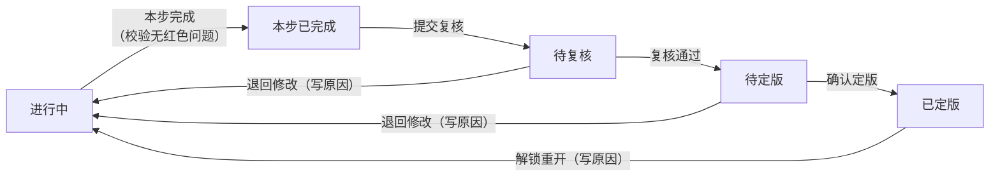
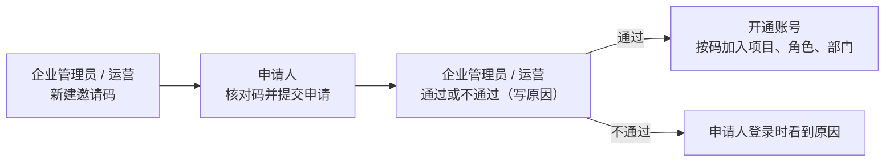

# 操作手册

「自驱战略 · 定三责」平台把《自驱战略落地》书中的三张管理检查表变成一步一步的在线工作：**定战略责 → 定目标责 → 定行动责**。每一步有一张成果表，企业填写、咨询师复核、企业确认后定版。下游表引用上游的定版内容；上游一改，下游会提示“上游已变更”。

- **入口**：`https://<域名>/x/dingze/`，用分配的账号登录。
- **适用版本**：插件 0.26.0（2026-10-13）。新版本改了什么见[更新记录](changelog.md)。

**按角色找章节：**

| 你是 | 读哪几章 |
|---|---|
| 所有人先读 | 第〇章（基本概念）→ 第一章（流程环节：全周期、单表流转、变更与例外、计划书收口、训练营、注册、专家咨询、引导缺口、画像） |
| 企业项目负责人、部门负责人、项目成员、只读成员 | 第二章 |
| 企业管理员（维护本企业账号和组织） | 第二章，重点看第 11 节 |
| 主咨询师、协作咨询师、被分派为专家的咨询师 | 第三章；改表的操作见第二章第 3、4 节 |
| 运营管理员、咨询管理员 | 第四章 |
| 查阅 | 第五章：权限速查、状态文字、快捷键、通知 |

---

## 〇、先了解这几件事

### 1. 三个阶段、24 项成果

| 阶段 | 做什么 | 主要的表 |
|---|---|---|
| 定战略责 | 把战略说清楚，并能衡量 | S1-01 六分法（必做）/ 战略屋（可选）、S1-02 战略地图、S1-03 逻辑表、S1-04 IPOOC（选做）、S1-05 KPI 筛选、S1-06 战略 KPI 表、S1-07 3—5 年分解 |
| 定目标责 | 定年度目标，找路径，把责任分到部门 | S2-03 目标路径系统表（定目标区 + 找路径区）、S2-01 解码地图、S2-08 关键项目、S2-04 RACI、S2-05 部门承接、S2-06 部门路径、S2-07 计分卡 |
| 定行动责 | 落实任务、节点、资源，汇成计划书 | S3-02 任务书（含 WBS）、S3-05 推进表、S3-06 资源匹配、S3-07 / S3-08 公司 / 部门年度经营计划书 |

- 全部 24 项与书中出处见[成果目录](artifact-catalog.md)。“成果”页显示“24 项 · 其中 19 张表独立定版”，其余是图形视图、内嵌表或方法底稿。
- **解锁规则**：同一阶段内，前一步“本步完成”后下一步才解锁（锁形图标）；上一阶段的 P0 表全部定版后，下一阶段才开启。

### 2. 一张表的生命周期

| 状态（表头文字） | 怎么到这里 | 下一步由谁做 |
|---|---|---|
| 进行中 | 开始填写，或被退回、被解锁重开 | 企业填写；企业项目负责人或部门负责人点“本步完成” |
| 本步已完成 | “本步完成”时校验通过，没有红色问题 | 陪跑：提交复核。自助：企业项目负责人自查复核 |
| 顾问在审 / 待复核 | 提交复核 | 主咨询师：复核通过，或退回修改 |
| 待你定版 / 顾问已审过 | 复核通过（或自查复核完成） | 企业项目负责人：确认定版，或退回修改 |
| 已定版（锁定） | 确认定版 | 只读。要修改，由企业项目负责人或主咨询师解锁重开（写原因，全员含咨询师收到通知） |
| 已退回修改：原因 | 复核或确认时退回，必须写原因 | 企业按原因修改后，重新走“本步完成” |

### 3. 两种服务方式

- **陪跑**：有主咨询师复核。训练营期间都是陪跑，结营后付费客户继续陪跑。
- **自助**：只有数字咨询师，没有人工复核。复核这一步改成企业项目负责人的“自查复核”，解锁重开也由企业项目负责人做。其余界面和陪跑一样。
- 服务方式由运营在建项目或结营时选定。

### 4. 两种“已变更”提示

- **上游已变更**：这张表引用的上游表改过了。表头提示旁有“看上游改了什么”，逐条列出上游哪里改了（改前 → 改后）。
  - 还没定版的表：本表跟着改好（校验条里能一键“按上游更新”的先点），再点“已核对”，提示才消失。**只保存不会消除提示。**
  - 已定版的表：由企业项目负责人或主咨询师判断（自助项目由企业项目负责人）：要跟着改就解锁重开；不受影响就点“已核对，保持定版”。下载的仍是定版内容。
  - 上游正在修改（被解锁重开）时不能“已核对”，等它重新完成后再核对。
- **上下游一致性检查**：带入下游的内容和上游对不上时，校验条会提示，能自动改的带一键按钮。例如：
  - 年度目标的指标值和 3—5 年分解（S1-07）不一致：“按 S1-07 更新”；
  - 关键项目没有分配 RACI、部门承接还没上计分卡、关键项目还没做项目化判定；
  - 任务书的牵头部门不是 RACI 里的 A：“改为××部”；任务书的时间、负责人和关键项目不一致：“按关键项目更新”；
  - 资源表的财务需求和任务书预算金额不一致：“按任务书预算更新”；
  - 上游条目改名或删除（战略地图 → 逻辑表 → IPOOC → 筛选 → 战略 KPI，解码地图 → 路径）：“按上游改名”，删除的会提示确认是否保留。
- **组织已变更**：部门有增删、改名、换负责人或改职责。只会提示在依赖组织的已定版表上（S2-04 / S2-05 / S2-06 / S2-07 / S3-08）。
  - 同一位判断人选“解锁重开”，或“不需要重开”并写一句理由。

### 5. 数字咨询师的规则

- 每个阶段有一位数字咨询师，在填写页右栏的“对话”里。
- 它**只出修改建议卡**，不会直接改你写的内容。确认后才写入草稿。
- 它会检索本企业的资料和已定版成果，并注明出处；只作参考，不当作企业事实。
- 书中方法和数字咨询师里标【待确认】的用语，尚待方法论签认，签认前不当同义词使用。

### 6. 登录与密码

- 平台**不开放公开注册**。账号由运营或本企业管理员开通，也可以凭邀请码申请（见第二章第 1 节）。
- 忘记密码：点登录页的“忘记密码”，按提示联系本企业管理员或运营重置。
- 打不开某个项目时，页面上有“回我的项目”。

---

## 一、流程环节

这一章按流程讲谁在什么时候做什么；具体按钮和页面的操作见后面各角色的章节。

### 1. 全周期总览

| 环节 | 负责人 | 在哪里做 | 产出 | 完成标志 |
|---|---|---|---|---|
| ① 开通与分派 | 运营管理员 | 运营管理 › 企业与开通，或训练营批次 | 企业空间、企业管理员账号、项目（场景、服务方式）、项目成员与角色 | 成员收到“你已加入项目”通知 |
| ② 项目启动 | 企业管理员、企业项目负责人 | 本企业（组织、成员）；资料；待办 | 部门与职责、成员所属部门、至少一份资料、至少一条已确认的画像、团队角色齐全 | 首页显示“项目启动已就绪”（没齐也可以先填表） |
| ③ 定战略责 | 企业填写，咨询师复核，企业项目负责人定版 | 定责 | S1-01～S1-07 | 本阶段 P0 表全部定版，定目标责开启 |
| ④ 定目标责 | 同上 | 定责 | S2-03（定目标 → 找路径）、S2-01、S2-08、S2-04～S2-07 | 本阶段 P0 表全部定版，定行动责开启 |
| ⑤ 定行动责 | 同上 | 定责 | S3-02、S3-05、S3-06，以及计划书 S3-07 / S3-08 | 公司级计划书确认，与任务书、推进表、资源表一起定版；部门计划书定版 |
| ⑥ 交付 | 企业项目负责人 | 成果 › 交付包 | 计划书 Word（带版本与来源）、各表 Excel、图片 | 导出记录里有定版版本的导出 |
| ⑦ 后续服务 | 运营 | 训练营 › 结营；专家咨询 | 每个项目的服务方式；专家意见 | 陪跑项目继续由主咨询师复核；自助项目由企业项目负责人自查复核 |

阶段内的顺序：前一步“本步完成”后下一步解锁；上一阶段的 P0 表全部定版后，下一阶段才开启。确需跳过顺序时，按本章第 4 节申请跳步例外。

### 2. 一张表的流转（陪跑项目）

| 步骤 | 谁做 | 系统检查 | 通知谁 |
|---|---|---|---|
| 填写、保存 | 企业项目负责人、部门负责人、项目成员；咨询师可修订 | 版本冲突（别人先保存了会提示刷新） | — |
| 本步完成 | 企业项目负责人、部门负责人 | 校验不能有红色问题；第一次会弹窗说明流程 | 主咨询师、协作咨询师：“本步完成，待提交复核” |
| 提交复核 | 企业项目负责人、部门负责人，或咨询师代为提交 | — | 主咨询师：“待复核” |
| 复核通过 | 主咨询师 | 再校验一次 | 企业项目负责人：“复核通过，待企业确认” |
| 退回修改 | 主咨询师（待复核时）；企业项目负责人（待定版时） | 必须写原因 | 企业项目负责人、部门负责人、主咨询师；原因显示在表头、首页和数字咨询师里 |
| 确认定版 | 企业项目负责人 | 再校验一次；弹窗列出与上一定版的差异、未处理建议、未解决批注、下游表 | 全体项目成员：“已定版（vN）”；引用它的下游表标“上游已变更”，通知企业项目负责人和主咨询师 |

### 3. 一张表的流转（自助项目）

与陪跑只有三处不同：

| 环节 | 陪跑 | 自助 |
|---|---|---|
| 本步完成后 | 通知咨询师，提交复核 | 通知企业项目负责人：“本步完成，待自查复核” |
| 复核 | 主咨询师复核通过 | 企业项目负责人做**自查复核**：完成检查、常见的坑、校验建议，逐条勾选或写明不改的理由，全部处理完进入待定版；通知部门负责人 |
| 定版后修改 | 企业项目负责人或主咨询师解锁重开 | 企业项目负责人解锁重开 |

### 4. 变更与例外

| 场景 | 什么时候出现 | 谁处理 | 怎么处理 | 结果 |
|---|---|---|---|---|
| 退回修改 | 复核或定版前发现问题 | 主咨询师；待定版时也可以是企业项目负责人 | 写清改什么 | 表回到进行中，按原因修改后重新“本步完成” |
| 解锁重开 | 已定版的表需要修改 | 企业项目负责人、主咨询师、咨询管理员 | 写原因 | 原定版版本保留；表回到进行中；全员收到通知；下游表标“上游已变更” |
| 上游已变更（下游未定版） | 上游表出了新版本或被重开 | 下游表的填写人 | “看上游改了什么”，本表跟着改好后点“已核对” | 提示消失；只保存不会消失 |
| 上游已变更（下游已定版） | 同上 | 企业项目负责人或主咨询师（自助项目为企业项目负责人） | 要跟着改就解锁重开；不影响就点“已核对，保持定版” | 下载的始终是定版内容，交付包注明上游已变更 |
| 影响清单 | 上游表重开或出了新版本 | 上游表的负责人 | 表头“下游 N 张待核对 · 影响清单”列出每张下游表的状态；已定版且待核对的可以勾选后一起解锁重开（写一次原因） | 逐张核对或重开；解锁重开的确认框里也会先列出影响清单 |
| 组织已变更 | 部门增删、改名、换负责人、改职责 | 企业项目负责人或主咨询师（自助项目为企业项目负责人） | 解锁重开，或“不需要重开”并写理由 | 理由记入审计；重开或重新定版后提示消失 |
| 跳步例外 | 确需在前一步完成前先做后一步 | 主咨询师、咨询管理员 | 通过插件接口批准，写原因 | 只放行“本步完成”，复核和定版照样校验 |
| 强制定版 / 强制退回 | 流程卡住、需要管理员介入 | 咨询管理员 | 通过插件接口执行，写原因 | 强制定版不跳过校验；全部记入审计并通知 |

### 5. 计划书收口

1. S3-02 任务书、S3-05 推进表、S3-06 资源匹配表各自走到**待定版**（陪跑项目：复核通过；自助项目：自查复核完成），不用单独定版。
2. 企业在 S3-07 公司级计划书里写企业录入的章节；执行摘要和其他同源章节自动汇总。
3. S3-07 走本步完成 → 复核通过 → 企业项目负责人确认定版。确认时四张表**一起定版**，并记下引用的上游版本。
4. S3-08 部门计划书按部门承接表分部门填写，走同样的流转。
5. 在“成果 › 交付包”下载定版的计划书 Word。之后上游再变，已定版的计划书内容不变，交付包会注明。

### 6. 训练营

| 时间 | 环节 | 谁 | 做什么 |
|---|---|---|---|
| 开营前 | 建批次 | 运营 | 名称、日期、地点、今日目标表 |
| 开营前 | 批量加企业、发账号 | 运营 | 导入企业名单 → 开通空间、企业管理员和项目 → 导入成员账号 → 下载账号清单，安全转交 |
| 开营前 | 营前准备 | 运营、企业项目负责人 | 按“组织与部门、资料与画像、项目团队”三项补齐；运营发提醒 |
| 每天开课前 | 定今日目标表 | 运营、主咨询师 | 在批次里换今日目标表 |
| 现场 | 填表与复核 | 企业、咨询师 | 企业按目标表填写、本步完成；咨询师在工作台按企业复核；数字咨询师现场答疑 |
| 现场 | 看进度 | 运营、咨询管理员 | 现场看板看每家卡在哪，点名跟进 |
| 结营 | 选服务方式 | 运营 | 付费客户选陪跑，其他选自助；项目转为企业内训；导出结营小结 |

### 7. 账号与邀请注册

- 申请时不建账号，审核通过才开通；密码是申请人自己设的。
- 企业项目负责人只能由运营指定。
- 直接开通的账号（运营、企业管理员、训练营批量发号）初始密码只显示一次，请通过安全渠道转交。

### 8. 专家咨询

| 状态 | 谁推进 | 下一步 |
|---|---|---|
| 待受理 | 申请人（项目里除只读成员外的人）提交议题和授权成果 | 咨询管理员 / 运营受理并分派专家；申请人可撤回 |
| 已受理 | 专家或管理员 | 预约沟通；申请人可撤回 |
| 已预约 | 专家或管理员 | 写纪要和意见（可改派）；申请人可撤回 |
| 已出意见 | 申请人、企业项目负责人或管理员 | 确认后关闭 |
| 已关闭 / 已撤回 | — | 结束 |

自助项目的申请先报价，付费后再受理；受理时项目改为陪跑并分派咨询师。

### 9. 引导缺口与方法改进

| 状态 | 谁 | 做什么 |
|---|---|---|
| 待评审 | 咨询师 | 在填写页记录缺口：缺少引导、引导有误、校验规则、方法口径或其他 |
| 已采纳 / 不采纳 | 运营或咨询管理员 | 评审；不采纳要写理由；通知记录人 |
| 已发布 | 运营或咨询管理员 | 采纳的规则随新版插件发布，填版本号；记入[更新记录](changelog.md) |

方法口径的签认事项（标【待确认】的内容）不走这个流程，等甲方签认后统一改，见[路线图](roadmap.md)第 1 节。

### 10. 企业画像条目

草稿 → **已复核**（咨询师或咨询管理员）→ **已确认**（企业项目负责人）。数字咨询师起草的条目一律是草稿。有人修改已复核或已确认的条目，条目会回到草稿。

---

## 二、企业用户

企业侧的项目角色有四种，另有一个系统角色“企业管理员”：

| 角色 | 主要职责 |
|---|---|
| 企业项目负责人 | 组织填写；本步完成；提交复核；**确认定版**（只有他 / 她能定版）；待定版时可退回；**解锁重开**（写原因，咨询师会收到通知）；自助项目里做自查复核 |
| 部门负责人 | 填写；本步完成；提交复核 |
| 项目成员 | 填写 |
| 只读成员 | 查看、批注 |
| 企业管理员（系统角色） | 维护本企业成员、组织部门、邀请注册；运营开通后可以自建项目（第 11 节）。这个身份本身不带定版权 |

### 1. 加入与登录

- **拿到账号的**：用运营或企业管理员当面（或通过安全渠道）转交的初始密码登录，首次登录后修改密码。
- **拿到邀请码的**：
  1. 在登录页点“有邀请码？申请加入”，或直接打开对方发来的邀请链接。
  2. 先核对邀请码，看清是哪家企业、哪个项目和角色。
  3. 填写姓名、登录名、自己的密码（至少 8 位，含字母和数字）、部门 / 岗位，然后提交。
  4. 等本企业管理员或运营审核。审核前登录会提示“还在审核中”；没通过会提示“没有通过审核”和原因。
- 登录后进入“我的项目”。每张项目卡片直接写着**下一步要做什么**，例如“去定版：公司级年度目标 · 路径”“改退回的表：项目任务书”，点卡片就到那张表。

### 2. 项目首页：待办

项目顶部有四个入口（咨询师多一个“专家咨询”），企业和咨询师同名。鼠标停在入口上会显示这一页管什么：

| 入口 | 用途 |
|---|---|
| 待办 | 最上面是“项目启动”，然后是最要紧的一件事（大按钮），以及正在流转的表和状态：顾问在审、已退回（带原因）、待你定版、上游有改动 |
| 定责 | 逐表填写三张检查表，完成后提交复核、定版；是主要工作区域（第 3、4 节） |
| 资料 | 填表前的准备与参考：资料库、组织与职责、企业画像；已确认成果只放一张链接卡，跳到「成果」（第 9 节） |
| 成果 | “成果清单”和“交付包”两个页签（第 8 节） |

**项目启动**：开始填表前要准备好的三件事，逐项显示还缺什么、该谁去做。

1. **组织与职责**：组织里建好了部门，项目里的企业成员都归到了部门。没有在系统里指定负责人的部门会单独提一句，但不算没准备好。
2. **资料与画像**：至少有一份资料；企业画像里至少有一条经企业项目负责人确认。
3. **团队与角色**：有企业项目负责人；有部门的话，还要有部门负责人参与。

三项都齐了，这里收成一行“项目启动已就绪”。没齐也可以先填表。训练营和企业内训对企业是同一套界面。

### 3. 填写页布局

填写页是一整屏的工作台。页面本身不滚动，只有中间的表格 / 导图区域滚动。

- **顶栏**（待办、资料、成果页和填表页是同一条）：
  - 左边是“自驱战略”和**项目名**。能进多个项目的账号（例如瀚川 2026 和 2027、带多个企业的咨询师），点项目名可以直接切换，切换后停在同一个入口。
  - 中间是入口：待办 · 定责 · 资料 · 成果（咨询师多一个“专家咨询”），当前入口有下划线。
  - 右边依次是：你在本项目的角色、项目成员头像、通知铃铛、右栏开关（只在填表页）、头像菜单。
- **显示设置**：头像菜单里的“显示设置”和 `/settings` 页是同一份设置（白天 / 黑夜 / 自动，字号小 / 中 / 大），只影响本机，换项目、下次登录都保留。头像菜单里还有“快捷键与帮助”。
- **左栏“项目路线”**：
  - 最上面是**三段阶段条**：定战略 ▸ 定目标 ▸ 定行动。当前阶段是深色，已完成的打 ✓，还没开启的带锁；点一下切换阶段。
  - 下面是阶段名和进度：“纵横贯通 · 必做表已定版 7 / 7”，有可提交、待复核的表也写在这里，再下面是一条进度条。
  - 按工作任务 → 实施步骤 → 子步骤排列。当前阶段的工作任务全部展开（可以手动收起），当前步骤左侧有竖条和浅色底，下面列出它的小节（找路径的五个子步骤、RACI 的三步等），当前小节用蓝色字。
  - 每个步骤两行：第一行是步骤名，右边是表号（如 S2-01/03）；第二行一句话说状态，如“已定版”“本步完成 · 可提交复核”“S2-08 本步完成后解锁”，上游改过的会多一个橙色“上游已变更”。
  - 图标：实心 ✓ 已定版，空心 ✓ 本步完成，半圆 进行中 / 复核中 / 退回，空圈 未开始，锁 未解锁。
  - 窗口窄时左栏自动收成图标条，这时位置行会出现“本表小节”下拉。
  - 最下面是“参考资料”（含组织与职责）和“本步产出 · 同一份数据”，默认收起，点标题展开；展开过的本机会记住。
- **上游输入 · 方法**：表名下面一行。“上游输入”列出这张表承接的上游表和它们现在的状态（已定版、复核中、填写中……），点一下跳过去；“方法”是书里这一步怎么做的一句话，点一下右栏打开“书中方法”。
  - 下方是“参考资料”和“组织与职责”入口，资料点开在右侧预览，不离开当前表；底部列出“本步产出 · 同一份数据”。
  - 窗口窄于 1280 像素时收成一列图标。收起 / 展开会在本机记住。
- **中间三行表头**：
  - 第一行：面包屑和状态（已退回 · 查看原因、已定版 · 说明、上游已变更、组织已变更），右侧是保存状态。保存状态显示“已保存 HH:MM · vN”；有改动时变成“有 N 处未保存 · 保存”，也可以按 Ctrl / ⌘ + S。
  - 第二行：《表名》和编号、思维导图 / 表格切换；“修订 · 批注 · 导出”收在一个小组里；最右边是流程按钮。
  - 流程按钮每种状态只有一个主按钮（实心）：进行中是“本步完成”，本步已完成是“提交复核”（自助项目是“自查复核”），待复核是“复核通过”，待定版是“确认定版”，已定版是“解锁重开”。退回、撤回这类次要动作是描边按钮。
  - 主按钮轮不到你时显示灰按钮，鼠标停上去写着谁可以点；企业在待复核时看到的是“等主咨询师复核”，旁边的“撤回修改”可以把表拉回来继续改（要写原因）。
  - 第三行：调整工具条（撤销 / 重做、下级、同级、升降级、上下移、移动到…、拆分、合并、批注、圈选、删除、缩放、小地图、快捷键）。
- **右栏四个页签**，各管一件事（页签下方有一句说明）：对话（问数字咨询师，答疑和改表）、批注（圈出来讨论）、修改（修改记录和历史版本）、书中方法（目的、怎么做、完成检查）。窗口窄于 1100 像素时右栏变成抽屉。
- **校验条**：
  - 红色是必须改的问题，没改完不能“本步完成”。
  - 黄色是建议。
  - 可选表（P1）的问题显示为“可选表，要做完还差 N 处”，不标红。
  - 点问题直接跳到对应的行或格，不在当前分区时会先切过去。
- **状态条**（最底下）：只显示状态——推得回来几处 / 推不回来几处、必须改几处、未解决批注几条、修订开或关、当前选中；批注和修订的开关在表头。右侧“书中方法”在右栏打开这张表的方法说明；按 **?** 打开全部快捷键。
- 很多表有“带入 / 导入”按钮，可以直接从上游表带入，不用重抄。
- 表名一律先写人话（如“责任分工矩阵”），书里的名称和编号小字跟在后面（《RACI 责任分解矩阵》· S2-04 · 表 3-17）。

### 4. 改表

#### 四种改法（所有表通用）

| 方式 | 怎么做 | 结果 |
|---|---|---|
| 直接改 | 点格子（或选中后直接打字 / Enter / F2）就改，Enter 保存、Tab 下一格、Esc 取消。思维导图里双击节点或按 F2，路径、衡量指标、指标值三项一起改 | 立刻生效，改过的地方左侧出现青色竖线 |
| 调结构 | 顶部工具条或行工具条。思维导图里可以拖到别的节点上换上级，或拖到两条之间调整顺序；表格里拖行左侧的拖动柄；表 3-10 可以“从 Excel 粘贴” | 松手前右侧说明“松开后会这样”；会让原上级推不回来时，默认把上级改成新合计（按住 Shift 松开则只移动）。删除后 8 秒内可撤销 |
| 批注 | 格子或节点上右键“插入批注”，或按 Ctrl + Alt + M。输入 @ 选成员（对方会收到通知），@数字咨询师 请它给修改建议。工具条“圈选”可以一次批注多处 | 画布上钉一个带编号的紫色水滴（①②③…）；没发出的批注显示为“草稿” |
| 对话 | 右栏“对话”里告诉数字咨询师想怎么改 | 它出**修改建议卡**：改哪几处、合计推不推得回来、必须改的问题会怎样变化；导图 / 表格同时切到预览。点“确认修改”写入草稿，“改一下”继续商量，“不采纳”丢弃且不写入任何内容 |

#### 撤销、修改记录、修订、保存

- **撤销 / 重做**：↶ ↷，或 Ctrl / ⌘ + Z、Ctrl / ⌘ + Shift + Z。连续敲同一格算一次，一次拖动算一次。
- **修改页签**：修改记录按天分组，写明几点、谁、从哪里改（直接改 / 调结构 / 对话 / 粘贴 / 撤销），以及关联的批注。
  - 可以按人、按来源筛选，可以导出 CSV。
  - 每条记录都能“定位”和“撤销”。
- **修订**：表头“修订”开关，或 Ctrl / ⌘ + Shift + E。选一个历史版本和当前内容对比。
  - 原值显示删除线、新值显示下划线；新增的行带绿色。
  - 删掉的行留在下面，可以一键“恢复”。
  - 表底汇总改了几处、增删几行、涉及几人。
- **保存**：每次保存生成一个新版本；有未保存的修改时离开页面会先提醒。两人同时改同一张表时，后保存的一方会被提示刷新。

#### 批注页签

- 可以按“全部 / 未解决 / @我”筛选，每条批注下可以直接回复。
- **按批注修改**：
  - 点紫色“按批注修改”，之后的修改都关联到这条批注。保存后自动回复“已按批注修改：……”，由提批注的人决定是否解决。
  - 点旁边的数字咨询师按钮，会把批注带到对话里，让它出修改卡。
- 能标记“已解决”的人：批注作者、企业项目负责人、主咨询师。

#### 思维导图 / 表格

找路径（S2-01、S2-03、S2-06）和任务书的 WBS 有两种展示，**是同一份数据**，改一边另一边跟着变。

- **思维导图**：适合共创和调结构。
  - 结构是“年度目标 → 四个层面（财务 / 客户 / 内部流程 / 学习与成长）→ 路径”。
  - 有下级的节点下方挂一个合计胶囊，如“700 + 300 = 1000”。推得回来显示绿色；推不回来显示橙色，并写“还差 N / 多 N”。
  - 只有指标和单位都相同才求和；口径不同时显示“共同支撑，不求和”。
  - Tab 新增下级，Enter 新增同级，Alt + Shift + 方向键调层级和顺序，Delete 删除，← → 折叠展开。
  - “小地图”显示全图缩略。
- **表格**：适合逐格核数字。
  - S2-03 默认“按层面”（表 3-10）。每个层面下面有校验行，推不回来时给出一键修正。
  - “横排表”是表 3-9 的只读预览。
- **图 3-7 参考卡**：浮在导图右上角，按增长战略 / 生产率战略提示一级路径的方向，点一项就加一条。
- S2-01 的“解码地图版式（图 3-3）”是只读的四层泳道图，用于汇报。

#### 责任分工矩阵（RACI，S2-04）的四条原则

按书第 3 章“横向到边”第二步，开一次“ARCI 责任澄清会”，逐项定角色：

- **A 唯一**：每行只能有一个 A。点另一格的 A，原来的 A 会自动移过去。
- **R 不可或缺**：每行至少一个 R。没有 R 不能“本步完成”。
- **R 不兼任 C / I**：同一格里 R 和 C / I 互斥，勾 R 会自动去掉 C / I，反之亦然。
- **C / I 合理控制**：C、I 太多会提示精简，不挡流程；多个 R、同一部门兼 A 和 R 也只提示。

表下方的“验证优化”按书表 3-18 横向（无 R / 无 A / 多 C / 多 I）和纵向（R 超载 / A 泛滥 / 全无 RA）检查。

### 5. 书中方法与数字咨询师

- **书中方法**（右栏第四个页签）：
  - 首屏写本步目的、怎么做和完成检查；展开后有准备、示例与反例（教学用，不是企业事实）、书中要点、常见的坑、来源与下一步。
  - 解码地图按当前子步骤（股东价值差距 / 客户价值主张 / 关键流程 / 战略资产）切换；目标路径系统表按“定目标 / 找路径”分区切换。
  - 内容标出处：【书】【平台】【建议】；尚待签认的用语标【待确认】。
  - 完成检查是方法自检，必须改的地方以校验条为准。
- **数字咨询师**（右栏“对话”）：
  - 起步卡会写当前表名、步骤和完成检查，并给三句可以直接点的开头：“帮我看这张表缺什么”“解释这一格”（带上你刚点过的格子）、“建议怎么填”。
  - 表被退回时，它会先说明退回原因。
  - 输入框左下角的 📎 可以上传资料（存进资料库）；⋯ 菜单里的“引用资料”可以让它参考已有资料。

### 6. 提交与定版

第一次点“本步完成”时，会先弹一个小窗说明后面的流程，之后不再提示。每一步谁做、通知谁，见第一章第 2、3 节。

#### 陪跑项目

1. 填写完毕，企业项目负责人或部门负责人点**本步完成**。有红色问题时不能点。
2. 企业项目负责人或部门负责人点**提交复核**，咨询师也可以代为提交。表头显示“等主咨询师复核（某某 日期 提交），审完会通知你”。
3. 主咨询师**复核通过**，或**退回修改**（写明原因）。被退回的表，表头和“待办”都会显示原因，数字咨询师也会先提到它。
4. 复核通过后，企业项目负责人点**确认定版**。确认弹窗会列出：
   - 与上一定版的差异（前 8 处，全部改动在“修改”页签里看）；
   - 还没处理的校验建议、没解决的批注数；
   - 定版后以它为依据的下游表；
   - 以后谁能解锁重开。
5. 定版后只读。不同意但愿意执行的意见，可以在表下方的“团队异议（反对但承诺执行）”里记录。
6. 待定版时如果发现问题，企业项目负责人可以**退回修改**（写明原因）。

公司级计划书（S3-07）确认时，它引用的任务书、推进表、资源匹配表必须已复核通过；确认后**四张表一起定版**。

#### 自助项目

1. 表“本步完成”后，企业项目负责人会收到“待自查复核”的通知。表头按钮是**自查复核**，没有“提交复核”。
2. 自查复核列出三类内容，逐条对照：没问题就勾上，不打算改的写一句为什么。全部处理完才进入“待定版”，记录留在审计里。
   - 这张表的**完成检查**；解码地图和目标路径系统表包含各子步骤、分区的检查。
   - **常见的坑**。
   - 还没处理的**校验建议**。
   - 左下角“请数字咨询师逐条看”会把清单发到对话里，让它逐条给意见。
3. 校验不通过同样不能自查复核。定版仍然只有企业项目负责人能做，确认时再校验一次。
4. 已定版的表需要修改时，企业项目负责人自己“解锁重开”，必须写原因。“上游已变更”“组织已变更”也由企业项目负责人判断。
5. 自助项目也可以申请专家咨询（付费，运营报价确认后受理）。付费后运营分派咨询师，项目改为陪跑，已定版的表保留。

### 7. 年度经营计划书（S3-07 / S3-08）

- 章节分两种：
  - **企业录入**：二 上年度总结、三 环境分析、七 风险与“不做什么”（部门级是“三不做”：不投入、不介入、不承担），以及八 指标字典补充说明。
  - **同源 · 自动汇总**：直接引用已定版的成果，不需要也不能重写。
- **执行摘要也是同源的**：
  - 公司级自动写出使命愿景、本年度战略 KPI 目标、公司级年度目标、关键项目（预算单位一致时给出合计），以及资源缺口。
  - 部门级写承接项、计分卡指标数、牵头项目和资源缺口。
  - 下面可以另写选填的“补充说明”，但不改动定版数字。
- 部门计划书按部门承接表（S2-05）里的部门分页签。缺的部门点“按部门承接表建立部门计划书”补上。
- 年度经营计划质询会在线下开，平台不设质询门禁。

### 8. 成果与导出

- **成果清单**：每张表的状态、版本、历史和版本对比。
- **成果历史**（成果清单的“历史”，或填写页表头的“历史”）：
  - 每次定版是一轮：第 1 次定版、第 2 次定版（优化）……之间的版本标“优化第 N 轮”，内训集中定版后回去继续优化，一眼看出改到了第几轮。
  - 每个版本都能点“查看”，在填写页只读打开那一版的完整内容；页面上方可以“和当前对比”或“回到当前版本”。版本对比显示行名和字段名，例如“燃气运营部 · 指标”。
- **交付包**：
  - 最上面是**下载计划书 Word**（公司级和部门级）；Excel 和图片在“其他表格与图片”里。
  - 已定版的计划书按定版时引用的上游版本生成，Word 里有“版本与来源”页、目录和页码。
  - 上游已变更时会注明，但下载的仍是定版内容。
- 填写页右上角的导出按钮导出最近一次**保存**的版本；未定版的文件标“草稿”。
- 图片导出：
  - S1-01 战略屋 / 六分法、S1-02 战略地图、S2-01 解码地图、S2-02 路径系统图可导出 PNG（适合汇报）或 SVG（矢量，可再编辑）。
  - 公司级计划书第一章自动附战略屋（或六分法表）和战略地图。
- S3-02 项目任务书可以单独导出 Word（项目清单 + 每个项目的任务书和 WBS）。
- 表一定版就成为资料的一部分，数字咨询师和专家咨询按定版内容引用；查看、对比、下载都在「成果」，资料页只放一张链接卡。
- 所有导出都记在“交付包 › 导出记录”。

### 9. 资料、组织与企业画像

“资料”页从上到下是：资料库、已确认成果（链接卡，跳到「成果」）、组织与职责、企业画像。对话里上传或引用的资料也都写入资料库。

- **资料库**：
  - 上传经营总结、行业报告、经营数据表等。支持 Word docx、PDF、Excel（xlsx / xls / xlsm / xlsb / ods）、txt / md / csv，单个不超过 20MB；也可以直接粘贴文字。
  - 平台保存原件并提取文字，数字咨询师检索时注明出处。扫描版 PDF 没有文字层，需要另外粘贴文字。
  - 填表时可以用对话框的 📎 顺手上传，文件同样进资料库。
- **组织与职责**：只读展示部门层级、负责人、职责，以及项目成员属于哪个部门。由企业管理员在“本企业”里维护（第 11 节）。
  - 用到组织的地方：
    - 责任分工矩阵（S2-04）的责任者列取自这里的部门，部门名下面小字显示职责；
    - 部门承接（S2-05）和部门计划书（S3-08）按部门展开。
  - 表定版后保留当时的部门；组织之后的变化按“组织已变更”处理（第〇章第 4 节）。
- **企业画像**：
  - 按“事实 / 假设 / 未知 / 待补”记录企业情况，每条注明来源。
  - 可以让数字咨询师根据资料起草，起草的条目一律为草稿。
  - 条目由咨询师复核、企业项目负责人确认。别人修改已复核或已确认的条目，会回到草稿。
  - 画像摘要会提供给各阶段的数字咨询师。

### 10. 专家咨询

遇到方法流程解决不了的关键分歧（战略取舍、路径合理性、责任冲突、资源约束），在项目的“专家咨询”页申请：

1. 写清议题和问题，勾选要授权专家查阅的**已定版成果**（以申请时的定版为准）。
2. 咨询管理员受理并分派专家 → 专家预约沟通时间与方式 → 专家写纪要和意见。
3. 申请人或企业项目负责人确认后关闭。出意见前申请人可以撤回。每一步都会通知相关人。

### 11. 企业管理员：本企业

侧栏“本企业”只有企业管理员能看到：

- **成员**：建本企业成员账号、重置密码。初始密码只显示一次，请通过安全渠道转交。
- **组织部门**：
  - 维护部门名称、上级、负责人（有账号选账号，没有账号填姓名）、职责。
  - 也可以“从 Excel 粘贴”整张组织表：先“下载模板”，填好后上传或粘贴，预览后导入；同名部门会更新。
- **成员所属部门**：给每个企业成员选部门，本企业所有项目一起生效。
- **邀请注册**：
  1. 新建邀请码，选加入哪个项目、项目角色、所属部门、名额和有效期（默认 14 天）；建好后自动复制邀请链接。
  2. 有人申请时你会收到通知，在页签里“通过”或“不通过”（不通过要写原因）。通过后才开通账号，密码是申请人自己设的。
  3. 被拒的申请不占名额，停用的码立即失效。
  4. 企业项目负责人只能由运营指定，你发的码不能给这个角色。
- **项目**：列出本企业的项目。运营为本企业打开“允许企业管理员自建项目”后，这里有“新建项目”：
  1. 填项目名称和年度（默认明年）。
  2. 分派成员：只能选本企业的账号，角色只有企业项目负责人、部门负责人、项目成员、只读成员；默认把你自己设为企业项目负责人，至少要有一位。
  3. 新项目是“企业内训 · 自助”。需要咨询师陪跑时，请运营改服务方式并分派咨询师。
  4. 建好后如果你是企业项目负责人，会直接进入新项目并打开“从已有项目带入”。
  - 开关没打开时，这里写“自建项目还没开通”，需要新项目请联系运营。

### 12. 从已有项目带入（企业项目负责人）

新一年的项目不用从空白开始，可以把往年项目里的表带进来再改。只有企业项目负责人能操作。

1. 打开新项目的“待办”页，点右上角“从已有项目带入”。
2. 选来源项目：只列本企业里你也参与的项目。
3. 勾选要带入的表，可以“全选可带入的”。每张表右边写着带哪一版：
   - 定版过的带定版内容（如“带已定版 v4”）；
   - 没定版过的带最新草稿（如“带草稿 v2”）。
4. 点“带入 N 张”。

规则：
- 带入后**一律是草稿**（进行中），照常本步完成、复核、定版，不会因为带入就跳过门禁。
- 本项目里还没开始的表直接带入；正在填写的表带入后作为新版本，原内容在“历史”里。已经本步完成、复核中或已定版的表不能带入（灰显并写明原因），需要的话先撤回或解锁重开。
- 还没解锁的表也可以先带入，解锁后打开就能看到。
- 只带表的内容，不带批注、修改卡和流转记录。版本历史里记为“从已有项目带入”，并注明来源项目和版本。
- 年度、目标值等按今年改；改完后校验条和一致性检查照常提示。

### 13. 企业常见情况

| 看到 | 怎么办 |
|---|---|
| 左栏这一步是锁形图标 | 前一步还没“本步完成”，或上一阶段的 P0 表还没全部定版 |
| “本步完成”点不了 | 校验条里还有红色问题，点问题跳过去改 |
| 已退回修改：原因 | 按原因修改，保存后重新“本步完成” |
| 上游已变更（未定版的表） | 点“看上游改了什么”，跟着改好后点“已核对”（只保存不会消失） |
| 上游已变更 / 组织已变更（已定版的表） | 企业项目负责人或主咨询师判断：要改就解锁重开（写原因），不影响就点“已核对，保持定版”（组织变更是“不需要重开”） |
| 校验条里有“按上游更新”之类的按钮 | 带入的内容和上游对不上，点按钮一键改成上游的值，记得保存 |
| 等主咨询师复核（某某 日期 提交） | 不用操作，审完会通知你 |
| 保存时提示别人已改过 | 刷新后再改；自己的修改记录在“修改”页签里 |

---

## 三、咨询师

| 角色 | 主要职责 |
|---|---|
| 主咨询师 | 复核通过 / 退回、确认前退回、解锁重开、判断“上游已变更”“组织已变更”（企业项目负责人也可以）、批准跳步例外、修订 |
| 协作咨询师 | 修订、提交复核、批注，协助主咨询师 |
| 被分派为专家的咨询师 | 专家咨询的预约、纪要和意见 |

项目里的咨询师入口和企业同名：待办、定责、资料、成果，另有专家咨询。改表、批注、修订的操作和企业相同，见第二章第 3、4 节。

### 1. 咨询师工作台

登录后先到**咨询师工作台**。这里跨企业汇总五类事项，可以按企业和阶段筛选：

- 待复核；
- 待提交复核（企业已本步完成）；
- 待企业确认；
- 上游已变更；
- 待跟进。

训练营期间先按企业筛选，再从最早提交的开始复核。

### 2. 复核一张表

1. 从工作台或通知打开这张表。企业已“本步完成”但没提交时，你也可以代为**提交复核**。
2. 看校验条：红色问题会挡住复核通过；黄色建议由你判断。
3. 右栏“修改”页签打开**修订**，选上一版对比。逐条看修改记录：谁改的、从哪里改（直接改 / 对话 / 粘贴…）、关联哪条批注。
4. 对照右栏“书中方法”里的完成检查。完成检查是方法自检，不等于校验。
5. 有意见时：
   - 小改动直接修订，修改记入修改记录，企业能看到。
   - 要企业改的，在那一格写批注。
   - 需要企业整体返工的，点**退回修改**，写清楚改什么。原因会显示在企业的表头、首页和数字咨询师里。
6. 没问题就点**复核通过，提交企业确认**，企业项目负责人会收到“待你定版”。

“成果”页的“AI 初稿 → 定版”一列，显示数字咨询师的最后一版初稿和最终定版之间的差异，用来改进方法和规则。

### 3. 定版之后

各种变更和例外的总表见第一章第 4 节。

- **解锁重开**：已定版的表需要修改时，点“解锁重开”并写原因。企业项目负责人也可以自己解锁重开，你会收到通知（原因写在通知里）；重新定版仍要你复核。
  - 原定版版本会保留。
  - 引用它的下游表会标“上游已变更”。
- **上游已变更**：
  - 下游表还没定版时，企业看“上游改了什么”、跟着改好后点“已核对”。
  - 下游表已定版时由你或企业项目负责人判断：要跟着改就解锁重开；不影响就点“已核对，保持定版”。下载的仍是定版内容。
  - 上游表上方有“下游 N 张待核对 · 影响清单”，可以一次看全，已定版且待核对的可以勾选后一起解锁重开。
- **组织已变更**：已定版的部门相关表上会出现“组织已变更 · 看变化”，你和企业项目负责人都会收到通知。
  - 需要按新组织调整，就解锁重开。
  - 不影响，就点“不需要重开”并写一句理由（记入审计）。
- **跳步例外**：确有需要跳过解锁顺序时，可以为某一步批准例外（写原因，记入审计）。
  - 例外只放行“本步完成”；复核和定版照样校验。
  - 门户界面上目前没有这个按钮，需要时请咨询管理员通过插件接口处理（第四章第 8 节）。

### 4. 结营后的项目

- 结营时运营为每个项目选服务方式：付费客户继续**陪跑**，由你复核；其余转**自助**，由企业项目负责人自查复核后定版，你不再收到复核通知。
- 自助项目申请专家咨询并付费后会转回陪跑，运营会重新分派你。

### 5. 企业画像

在“资料 › 企业画像”里复核画像条目。条目复核后，再由企业项目负责人确认。

### 6. 记录引导缺口

发现数字咨询师没引导到、引导错了，或者校验口径与书不符时：

1. 在填写页右栏数字咨询师下方点“记录引导缺口”。
2. 写明缺口和期望的引导。对话摘录请去掉企业敏感信息。
3. 运营或咨询管理员评审后会通知你；采纳的规则随新版本发布。

这些记录也是之后“咨询师案例与经验知识库”的素材（见[路线图](roadmap.md)第 5 节）。

### 7. 作为专家

被分派为专家时会收到通知。在侧栏“专家咨询”打开申请：

1. 查阅企业授权的已定版成果。
2. 预约沟通时间与方式。
3. 填写纪要和意见。

### 8. 方法口径提醒

- 书中方法里的【待确认】用语（如“经营模式 / 老客户转介绍”与书中“新层次 / 忠诚度”的对应）尚待签认。辅导时按书中原词讲，不要把它们当同义词。
- 计划书的执行摘要由定版成果自动汇总；企业只写补充说明。质询会在线下进行。
- 数字咨询师只出修改卡，不直接改企业写的内容。发现它说法不对，记一条引导缺口。

---

## 四、运营与管理

| 系统角色 | 能做什么 |
|---|---|
| 运营管理员 | 运营管理全部页面：看板、企业与开通、训练营、咨询团队、方法与规则包；受理专家咨询、评审引导缺口 |
| 咨询管理员 | 运营管理全部页面；咨询师工作台；对项目里的表解锁重开、强制定版、强制退回、批准跳步例外（都要写原因）；受理专家咨询、评审引导缺口 |

侧栏“运营管理”下有以下页面。

### 1. 运营看板（默认页）

- 各企业项目的阶段进度（P0 定版数）。
- 待办积压：待复核、待确认、待更新、未解决批注。
- 数字咨询师用量：近 30 天和累计的对话轮次、Token。只记录，不计费。
- 可以按企业、训练营批次筛选，也可以勾“只看有待办”。

### 2. 企业与开通

1. **开通企业**：自动建立独立空间和企业管理员账号。
2. **成员与组织**：维护企业成员、组织部门（含职责、没有账号的负责人、Excel 导入）和成员所属部门。
3. **允许企业管理员自建项目**：在企业的“项目与分派”页签顶部有开关，默认关闭。打开后，这家企业的企业管理员可以在“本企业 › 项目”里自己建项目（企业内训 · 自助，只能分派本企业账号，见第二章第 11 节）；需要陪跑时由运营改服务方式并分派咨询师。
4. **新建项目**：
   - 选场景：训练营 / 企业内训；
   - 选服务方式：陪跑 / 自助；
   - 分派项目成员和项目角色。
   - 陪跑项目没有主咨询师时会提示；自助项目不需要咨询师。
   - 企业项目负责人只能由运营指定。
5. **停用 / 启用企业**：停用后该企业成员立即无法打开项目；运营和咨询管理员仍可查看。
6. **邀请注册**：企业页的“邀请注册”页签和企业管理员看到的一样（第二章第 11 节）。企业没有管理员时，申请通知发给运营。

新账号的初始密码只在创建时显示一次。请通过安全渠道转交，并提醒对方首次登录后修改。

### 3. 咨询团队

创建咨询师、咨询管理员、运营管理员账号，重置密码。要给某家企业做专家的咨询师，需要先加入该企业。

### 4. 训练营批次

按时间排的环节总表见第一章第 6 节。

训练营只是运营侧的组织方式，企业看到的界面和企业内训一样。一期训练营按下面的顺序走：

1. **新建批次**：填名称、开营 / 结营日期、地点、状态（筹备中 / 进行中 / 已结营），以及“今日目标表”。现场看板按今日目标表看进度，每天开课前可以换。
2. **批量加企业**：
   - 选本期的主咨询师和协作咨询师，下载“训练营企业名单模板”填好后上传（或从 Excel 粘贴），预览无误后开通。
   - 每家企业会建立独立空间、开通企业管理员（同时是企业项目负责人），并建好本期项目。
   - 某一行出错（如登录名已被使用）不影响其他行。
   - 已开通的企业项目可以用“编入已有项目”加进来。
3. **批量发账号**：营前准备表里每家企业一行，点“批量发账号”，用“项目成员账号模板”填姓名、登录名、项目角色、部门。
   - 新账号开为这家企业的成员，并按角色和部门加入项目；登录名已存在的只加入项目。
   - 部门名称要和企业组织表一致。
4. **转交密码**：开通结果里可以“下载账号清单”（CSV）。初始密码只显示这一次，请通过安全渠道转交。
5. **营前准备**：每家企业的三件事（组织与部门、资料与画像、项目团队）显示已就绪 / 部分就绪 / 待准备，以及具体缺什么。这和企业首页的“项目启动”是同一份清单。
   - “提醒未就绪的 N 家”会给这些企业的项目负责人发通知，写明缺什么；也可以单独提醒某一家。
6. **现场看板**：按今日目标表逐家显示状态和卡点（待复核提交、待复核、待确认、待更新、未解决批注），以及三阶段进度和最近动作。点企业名进入项目。
7. **结营**：
   - 为每个项目选结营后的服务方式：付费客户选陪跑，其他选自助。确认后项目转为企业内训，批次标为已结营；数据和已定版成果都不变。
   - “导出结营小结”下载各企业的三阶段进度、已定版数、导出次数、数字咨询师对话轮次和结营后服务方式。

### 5. 方法与规则包

- **规则包**页签：成果目录、每张表的书中方法（目的、怎么做、完成检查），以及数字咨询师。只读。
- **引导缺口**页签：评审咨询师记录的缺口。
  1. 选“采纳”或“不采纳”，不采纳要写理由。
  2. 采纳的改写规则，随新版插件发布后标“已发布”并填版本号。
  3. 每次评审都会通知记录人。

### 6. 专家咨询受理

侧栏“专家咨询”：

- 受理新申请，从该企业空间里已有的咨询师中分派专家，可以改派。
- 也可以代为预约、填写意见。
- 自助项目的申请要先报价，确认付费后再受理，并把项目改为陪跑、分派咨询师。

### 7. 方法口径的签认

书中方法、校验和数字咨询师里标【待确认】的内容，以及计分卡规则、KPI 数量硬限、S2-02 是否单列 P0 等事项，等甲方签认后再改。清单和进度见[路线图](roadmap.md)第 1 节。签认后的改动会记在[更新记录](changelog.md)里。

### 8. 管理员的特殊操作

| 操作 | 谁能做 | 说明 |
|---|---|---|
| 解锁重开 | 企业项目负责人、主咨询师、咨询管理员 | 在表头操作，写原因 |
| 强制定版 | 咨询管理员 | 跳过复核和企业确认，但**不跳过校验**；写原因，记入审计 |
| 强制退回 | 咨询管理员 | 可以退回已定版的表；写原因，记入审计 |
| 跳步例外 | 主咨询师、咨询管理员 | 只放行“本步完成”，复核和定版照样校验；写原因，记入审计 |

后三项在门户界面里没有按钮，需要时通过插件接口（资源 `dingze`）执行，见[发布与部署](deploy.md)和[系统架构](architecture.md)。这些操作只用于确有必要的情况，不能用来绕过校验。

### 9. 安全与运维要点

- 一个企业对应一个独立空间。企业之间的项目、成果、通知、导出、批注、资料、画像、专家咨询互不可见。
- 公开注册已关闭，邀请注册要经过审核。邀请码的限流计数存在进程内，多实例部署前要改成共享存储。
- 实例上的钉钉认证器开着“自动注册”。关闭它会影响同一实例上的其他应用，需要另行决定。
- 邮件通知要先在通知管理里建名为 `dingze-email` 的通道并配置 SMTP；站内通知开箱即用。
- 插件和门户的发布步骤见[发布与部署](deploy.md)；每个版本改了什么见[更新记录](changelog.md)。

---

## 五、附录

### 1. 权限速查

| 操作 | 企业项目负责人 | 部门负责人 | 项目成员 | 只读成员 | 主咨询师 | 协作咨询师 | 咨询管理员 |
|---|---|---|---|---|---|---|---|
| 填写、保存 | ✓ | ✓ | ✓ | | ✓（修订） | ✓（修订） | |
| 批注、回复 | ✓ | ✓ | ✓ | ✓ | ✓ | ✓ | |
| 本步完成 | ✓ | ✓ | | | | | |
| 提交复核（陪跑） | ✓ | ✓ | | | ✓ | ✓ | |
| 复核通过（陪跑） | | | | | ✓ | | |
| 自查复核（自助） | ✓ | | | | | | |
| 退回修改 | ✓（待定版时） | | | | ✓ | | 强制退回 |
| 确认定版 | ✓ | | | | | | 强制定版 |
| 解锁重开 | ✓ | | | | ✓ | | ✓ |
| 跳步例外 | | | | | ✓ | | ✓ |
| 确认画像条目 / 复核画像条目 | 确认 | | | | 复核 | 复核 | |

企业管理员、运营管理员是系统角色，负责账号、组织和开通，不参与表的流转。

### 2. 表头状态文字对照

| 表头文字 | 意思 |
|---|---|
| 本步已完成（还没交给顾问复核） | 陪跑项目，等提交复核 |
| 本步已完成（还没自查复核） | 自助项目，等企业项目负责人自查复核 |
| 等主咨询师复核（某某 日期 提交） | 已提交，等主咨询师 |
| 顾问已审过（某某 日期 通过），待你定版 | 等企业项目负责人确认定版 |
| 已退回修改：原因 | 按原因修改 |
| 已定版，但上游表有改动：由企业项目负责人或主咨询师判断是否解锁重开 | 自助项目里写“由企业项目负责人判断” |
| 可选表，可以跳过；要做完还差 N 处 | P1 表，不挡后续步骤 |

### 3. 常用快捷键

| 按键 | 作用 |
|---|---|
| Ctrl / ⌘ + S | 保存 |
| Ctrl / ⌘ + Z、Ctrl / ⌘ + Shift + Z | 撤销、重做 |
| Ctrl / ⌘ + Shift + E | 修订开关 |
| Ctrl + Alt + M | 在选中处插入批注 |
| Tab / Enter（导图） | 新增下级 / 同级 |
| Alt + Shift + 方向键（导图） | 调层级和顺序 |
| F2 | 编辑当前格子或节点 |
| ? | 全部快捷键 |

### 4. 通知

右上角铃铛显示站内通知，点通知直达对应的表、批注或咨询。通知类型有：

- 待复核、待自查复核、待确认、退回、定版、重开；
- 上游已变更、组织已变更；
- 加入项目、批注与 @；
- 专家咨询进展、引导缺口评审结果、邀请注册申请、营前提醒。
